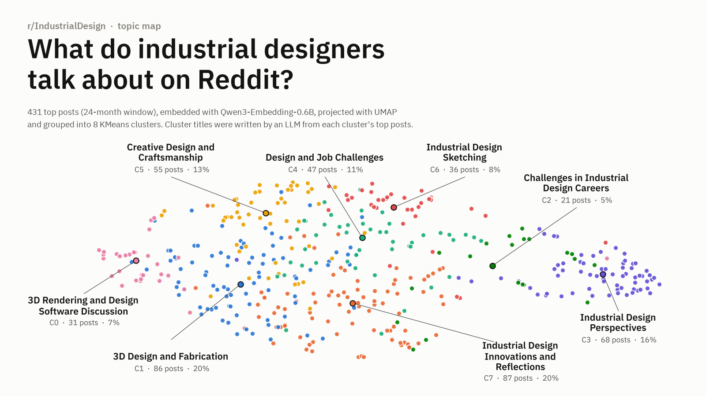
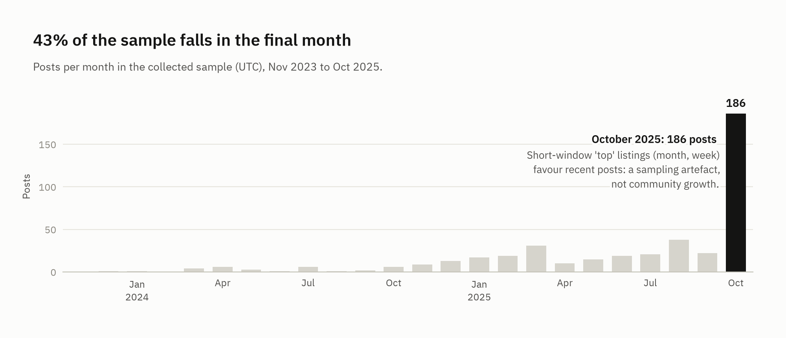
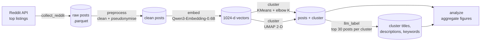
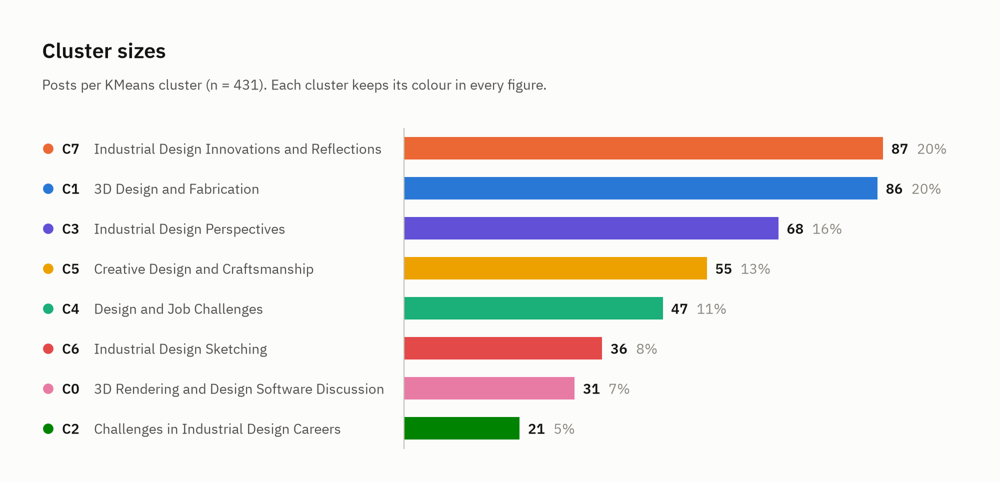
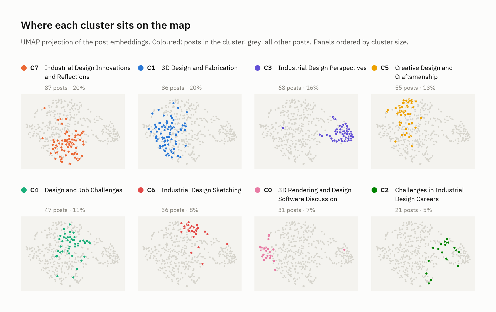
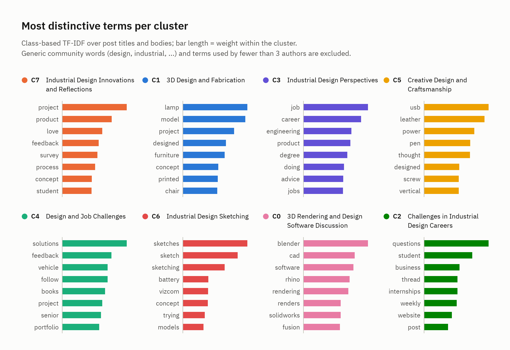
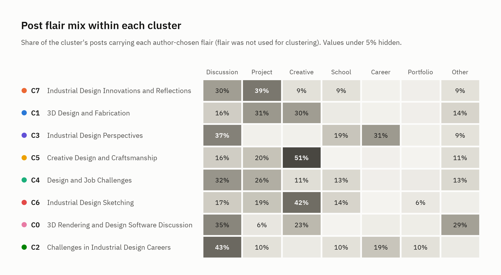
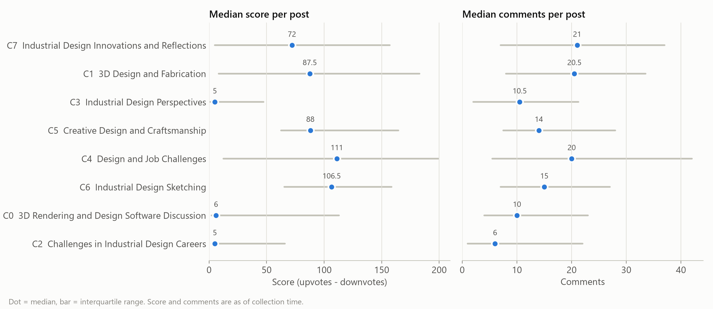
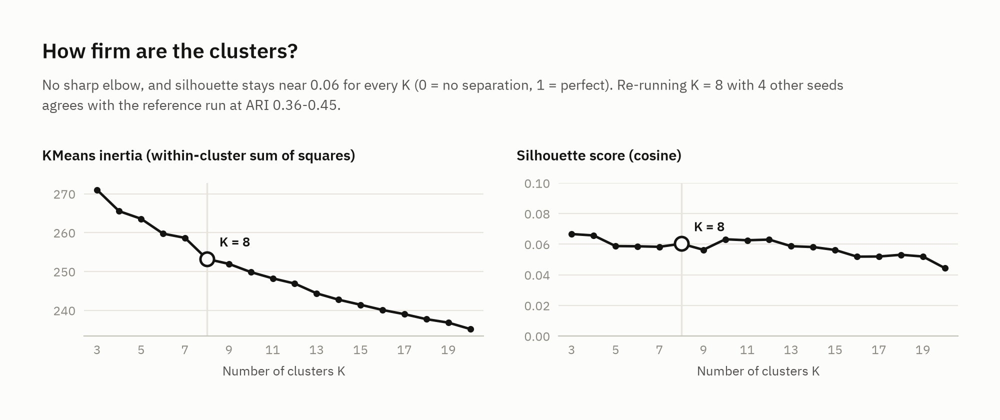

# What Do Industrial Designers Talk About on Reddit?

**Embedding-based topic mapping of r/IndustrialDesign: 431 top posts, 8 clusters, LLM-written cluster summaries.**




## Motivation

Online communities are where many designers learn, ask for critique, show work, and talk about their careers. This small project looks at the discourse of one of them, the [r/IndustrialDesign](https://www.reddit.com/r/IndustrialDesign/) subreddit, and asks a simple descriptive question:

> **What do industrial designers talk about when they talk to each other online?**

It is an exploratory, computational first pass: collect highly-ranked posts, embed them with a sentence-embedding model, cluster the embeddings, and use an LLM to propose a readable name for each cluster. The method follows the exploratory stage of Pataranutaporn et al.'s computational analysis of r/MyBoyfriendIsAI ([arXiv:2509.11391](https://arxiv.org/abs/2509.11391)), applied to a design community (see [Method](#method-adapted-from-pataranutaporn-et-al-2025)). The output is a map of themes, not a validated taxonomy (see [Limitations](#limitations)).

## Dataset

| | |
|---|---|
| Source | r/IndustrialDesign, via the official Reddit API (PRAW) |
| Sampling | Union of the subreddit's **top** listings for `all`, `year`, `month`, and `week`, filtered to the study window |
| Study window | 2023-11-01 to 2025-11-01 (24 months) |
| Posts collected | 441 |
| Posts analysed | **431** (after dropping posts with fewer than 20 characters of title + body) |
| Earliest / latest post | 2023-12-03 / 2025-10-31 (UTC) |
| Post format | 28% text posts, 72% link / image / gallery posts (titles still carry text) |
| Clusters | **8** (KMeans, K chosen by an elbow heuristic over K = 3 to 20) |

The sample is heavily skewed toward recent posts: **186 posts (43%) were created in October 2025**, the last month of the window. This is a side effect of the sampling strategy (the `month` and `week` top listings return recent posts), not evidence that the community suddenly grew.



## Pipeline



| Stage | Module | Output |
|---|---|---|
| Collect | `src/collect_reddit.py` | `data/raw/r_industrialdesign_top.parquet` |
| Pre-process | `src/preprocess.py` | `data/processed/posts_clean.parquet` (title + body as `text`, short posts removed, authors pseudonymised) |
| Embed | `src/embed.py` | `models/embeddings_qwen3.npz` (L2-normalised float32, 1024-d) |
| Cluster | `src/cluster.py` | `data/processed/posts_with_clusters.parquet` (KMeans label on the full embeddings, UMAP 2-D coordinates for display) |
| Label | `src/llm_label.py` | `data/processed/cluster_summaries.json` (OpenAI Responses API, Anthropic fallback) |
| Analyse | `src/analyze.py` | `figures/*.png`, `figures/*.svg` |

KMeans runs on the 1024-dimensional embeddings; UMAP (cosine, 15 neighbours, `min_dist` 0.1) is used only to draw the map.

## Method: adapted from Pataranutaporn et al. (2025)

The pipeline reuses the exploratory stage of ["My Boyfriend is AI": A Computational Analysis of Human-AI Companionship in Reddit's AI Community](https://arxiv.org/abs/2509.11391) (Pataranutaporn, Karny, Archiwaranguprok, Albrecht, Liu & Maes, 2025), which mapped the themes of r/MyBoyfriendIsAI and then coded posts with LLM classifiers. This project kept the first half and added non-LLM cross-checks in place of the second.

| Step | Reference study (r/MyBoyfriendIsAI) | This project (r/IndustrialDesign) |
|---|---|---|
| Data | 1,506 top-ranked posts, Dec 2024 to Aug 2025 | 431 top-ranked posts, Dec 2023 to Oct 2025 |
| Text | Title + body | Title + body, posts under 20 characters dropped, authors pseudonymised |
| Embedding | Qwen3-Embedding-0.6B | Qwen3-Embedding-0.6B (same model) |
| Projection | UMAP to 2-D for visualisation | UMAP to 2-D for visualisation (cosine) |
| Number of clusters | Elbow on WCSS over K = 3 to 20, second-derivative rule (K = 6) | Same rule and range (K = 8) |
| Sub-clusters | Repeated the elbow within each cluster | Not done |
| Cluster labels | Claude Sonnet 4 writes a title, summary, and key topics from representative posts | An LLM (OpenAI Responses API, Anthropic as fallback) writes a title, description, and 5 to 8 keywords from each cluster's 30 top-scoring posts |
| Label check | Reviewed and verified by the researchers | Cross-checked against c-TF-IDF terms and author-chosen flair; no human review |
| Post-level coding | 19 LLM classifiers (post type, tone, platforms, relationship dynamics, ...) | Planned, not implemented |
| Added here | | Engagement by cluster, sampling-bias check by month, cluster robustness check (silhouette, seed stability) |

In short, the two projects share the clustering and labelling recipe; this one stops at the theme map and adds checks that do not depend on an LLM.

## Results

### The eight clusters

Titles, descriptions, and keywords were generated by an LLM from the 30 highest-scoring posts of each cluster; the one-line descriptions below are condensed from those summaries. The last column lists the cluster's most distinctive words, computed independently from all posts with class-based TF-IDF (see below).

| | Cluster (LLM title) | Posts | Share | What it is about (condensed from the LLM summary) | LLM keywords | Distinctive terms (c-TF-IDF) |
|---|---|---:|---:|---|---|---|
| C7 | Industrial Design Innovations and Reflections | 87 | 20.2% | Reflections on design past and present, including nostalgia for early-2000s products, alongside personal projects | creativity, innovation, nostalgia, aesthetics | project, product, love, feedback, survey |
| C1 | 3D Design and Fabrication | 86 | 20.0% | Built projects made with 3D printing, CNC, and other processes (furniture, lamps, desk objects), shared for feedback | 3D printing, CNC machining, fabrication, prototype | lamp, model, project, designed, furniture |
| C3 | Industrial Design Perspectives | 68 | 15.8% | Personal questions about careers, education paths, job seeking, and the future of the field, including AI | career, education, AI and technology, job market | job, career, engineering, product, degree |
| C5 | Creative Design and Craftsmanship | 55 | 12.8% | Crafted and concept objects (leather goods, watches, modular displays) mixing handcraft and digital modelling | craftsmanship, leatherwork, 3D modeling, custom creations | usb, leather, power, pen, thought |
| C4 | Design and Job Challenges | 47 | 10.9% | Project feedback requests mixed with frustration about job and internship expectations | design projects, job market, internships, feedback | solutions, feedback, vehicle, follow, books |
| C6 | Industrial Design Sketching | 36 | 8.4% | Sharing and critiquing product sketches: proportion, shading, perspective, and AI-assisted rendering tools | sketching, proportion, shading, Vizcom.ai | sketches, sketch, sketching, battery, vizcom |
| C0 | 3D Rendering and Design Software Discussion | 31 | 7.2% | Choosing and combining CAD and rendering software, plus hardware advice | 3D rendering, Blender, SolidWorks, CAD | blender, cad, software, rhino, rendering |
| C2 | Challenges in Industrial Design Careers | 21 | 4.9% | Student and early-career questions on portfolios, internships, money, and the job market | career challenges, portfolio, internships, networking | questions, student, business, thread, internships |



### Where the clusters sit

Each panel highlights one cluster on the shared UMAP map. Software (C0), sketching (C6), craft objects (C5), and career / perspective posts (C3) form compact regions; the two largest clusters (C7, C1) and the two smaller career-related clusters (C4, C2) are spread more widely, which suggests their boundaries are softer.



### What distinguishes each cluster

To cross-check the LLM labels with something that does not depend on an LLM, `src/analyze.py` computes class-based TF-IDF (one document per cluster, as in BERTopic) over post titles and bodies. Generic community words (*design*, *industrial*, ...) are removed, and a term must be used by at least three different authors so that one poster's brand or project name cannot surface as a theme. The terms agree well with the LLM titles for software (*blender, cad, rhino*), sketching (*sketch, vizcom*), fabrication (*lamp, furniture, printed, chair*), and careers (*job, career, degree*); they are much less specific for C7 and C4, whose LLM titles are correspondingly vague.



### Post flair as a second cross-check

Reddit post flair is chosen by the author and was **not** used for clustering, so it offers an independent view. Show-and-tell clusters lean on the *Creative* and *Project* flairs (C5: 51% Creative; C6: 42% Creative), while C3 and C2 are dominated by *Discussion*, *Career*, and *School*.



### Engagement

Median score and comment counts per cluster. Visual show-and-tell clusters (C4, C6, C5, C1, C7) have median scores of 72 to 111, while the question-style clusters C0, C2, and C3 have median scores of 5 to 6.

This gap should **not** be read as "the community does not care about careers or software". Posts in C0, C2, and C3 are mostly text posts (63% vs 14% in the other clusters) and mostly from the final month (68% vs 34%), and posts from October 2025 have a median score of 2 versus 122 for older posts in the sample. Recency and post format, both artefacts of how the sample was drawn, explain much of the difference.



### How firm are the clusters?

`src/analyze.py` refits KMeans over the same K range to check how much structure there is to find. The answer is: not much.

- **No clear elbow.** Inertia falls almost linearly from K = 3 to 20. K = 8 has the largest bend, but only slightly.
- **Weak separation.** The cosine silhouette score is about 0.06 at every K (0 means no separation, 1 means perfect).
- **Moderate stability.** Re-running K = 8 with four other random seeds agrees with the reference run at an adjusted Rand index of 0.36 to 0.45, so many posts change cluster from run to run.



The posts form a continuum rather than separate groups. The compact regions on the map (software, sketching, craft, careers) are consistent with the term and flair cross-checks and are the most trustworthy themes; the exact boundaries, the number eight, and the softer clusters (C7, C4, C2) should be read loosely.

### Summary

Within this sample, the subreddit's highly-ranked content splits roughly into two kinds of discourse:

- **Showing work** (C1, C5, C6, and much of C7 and C4; about 72% of posts): fabricated objects, crafted products, sketches, and concept projects, usually shared for feedback.
- **Asking about the profession** (C3, C2, C0; about 28% of posts): careers, education, the job market, and which software to learn.

These are descriptive patterns in a small, recency-skewed sample of top posts, not population estimates for the community.

## Limitations

- **Sampling bias.** Only *top* listings were collected, so the sample over-represents popular and recent posts (43% from the final month) and omits most ordinary posts and all comments. 431 posts is small.
- **Weak cluster structure.** KMeans assumes roughly spherical clusters of similar size, and K = 8 came from a second-difference elbow on an almost linear inertia curve. Silhouette is about 0.06 and seed-to-seed agreement is ARI 0.36 to 0.45 (see [How firm are the clusters?](#how-firm-are-the-clusters)). Sub-clustering, as in the reference study, or a density-based method such as HDBSCAN was not tried.
- **LLM labels are not human-validated.** Titles and descriptions were written by an LLM from the 30 top-scoring posts of each cluster. Some are vague or overlap (C3 vs C2, C4 vs C7). The c-TF-IDF terms and flair mix are offered as cross-checks, not as validation; no human coding or inter-rater agreement was done.
- **Quantitative post labelling was not implemented.** An earlier plan to classify every post by content type, emotion, purpose, and tools was never implemented; its placeholder module has been removed and no such results are reported.
- **Text only.** Most posts are image or gallery posts; only their titles (and any body text) were embedded. Visual content was not analysed.
- **Engagement is a snapshot.** Scores and comment counts were recorded once at collection time and are not comparable between old and very recent posts.

## Reproduce

> The collected data, embeddings, and LLM outputs are **not** included in this repository (see [Ethics](#ethics)). The commands below re-collect data, which will differ from the snapshot analysed here.

### 1. Environment

```bash
# conda
conda env create -f environment.yml
conda activate reddit-cmf

# or pip / uv
python -m venv .venv && source .venv/bin/activate   # Windows: .venv\Scripts\activate
pip install -r requirements.txt
```

### 2. Credentials

- **Reddit:** copy `configs/praw.ini.example` to `praw.ini` in the repository root and fill in your app credentials (or set `PRAW_CLIENT_ID`, `PRAW_CLIENT_SECRET`, `PRAW_USER_AGENT`, `PRAW_USERNAME`, `PRAW_PASSWORD`). Check with `python -m src.check_auth`.
- **LLM (labelling stage only):** copy `.env.example` to `.env` and set `OPENAI_API_KEY` and/or `ANTHROPIC_API_KEY`.
- **Pseudonyms (optional):** set `ANON_SALT` in `.env` to a private value before running `preprocess --anonymize`.

`praw.ini` and `.env` are gitignored.

### 3. Run the stages

All stages read `configs/config.yaml` and are run from the repository root.

```bash
python -m src.collect_reddit --config configs/config.yaml --mode top
python -m src.preprocess     --config configs/config.yaml --anonymize
python -m src.embed          --config configs/config.yaml
python -m src.cluster        --config configs/config.yaml
python -m src.llm_label      --config configs/config.yaml
python -m src.analyze        --config configs/config.yaml
```

`src.analyze` needs only the clustered parquet and `cluster_summaries.json`, so the figures can be regenerated without any API access once those exist.

## Repository structure

```
.
├── configs/
│   ├── config.yaml           # subreddit, time window, paths, model and clustering parameters
│   └── praw.ini.example      # template for Reddit API credentials
├── data/                     # raw and processed posts (gitignored)
├── docs/ETHICS.md            # data-handling principles
├── figures/                  # committed PNG/SVG figures; interactive HTML is gitignored
├── models/                   # embedding matrices (gitignored)
├── notebooks/                # one short guide per pipeline stage
├── src/
│   ├── collect_reddit.py     # collect top posts via PRAW
│   ├── preprocess.py         # build text field, filter short posts, pseudonymise authors
│   ├── embed.py              # sentence embeddings (Qwen3-Embedding-0.6B)
│   ├── cluster.py            # KMeans with elbow K, UMAP projection, interactive plot
│   ├── llm_label.py          # LLM cluster titles, descriptions, keywords
│   ├── analyze.py            # aggregate figures, c-TF-IDF terms, cluster robustness check
│   ├── check_auth.py         # verify Reddit credentials
│   ├── reddit_client.py      # PRAW client factory
│   └── utils.py              # logging, IO, config, pseudonymisation
├── environment.yml
├── requirements.txt
└── LICENSE
```

## Ethics

Only public posts were collected, author names were pseudonymised during pre-processing, and no raw data, usernames, post IDs, or post text are published in this repository. Figures and tables report cluster-level aggregates and paraphrased themes only. See [docs/ETHICS.md](docs/ETHICS.md).

## Reference

Pataranutaporn, P., Karny, S., Archiwaranguprok, C., Albrecht, C., Liu, A. R., & Maes, P. (2025). "My Boyfriend is AI": A Computational Analysis of Human-AI Companionship in Reddit's AI Community. arXiv:2509.11391. https://arxiv.org/abs/2509.11391

## License

Code is released under the [MIT License](LICENSE). Reddit content remains subject to Reddit's terms and the rights of its authors and is not redistributed here.
