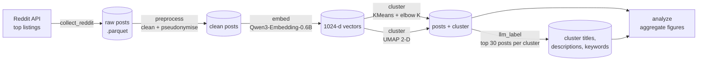

# What Do People Talk About on r/IndustrialDesign?

**Embedding-based topic mapping of [r/IndustrialDesign](https://www.reddit.com/r/IndustrialDesign/): 431 top posts, 8 clusters, LLM-written cluster summaries.**

[](https://www.reddit.com/r/IndustrialDesign/)
[](https://arxiv.org/abs/2509.11391)

[](https://huggingface.co/Qwen/Qwen3-Embedding-0.6B)
[](LICENSE)


**Main findings**

- Roughly 7 in 10 top posts fall in clusters about showing work: things people built, crafted, sketched, or rendered, usually posted to get feedback.
- The rest ask about the profession: careers, school, the job market, and which software to learn.
- The groups overlap a lot. Software, sketching, craft, and career posts form clear regions on the map; the other boundaries are loose (see [How firm are the clusters?](#how-firm-are-the-clusters)).

## Motivation

Students, working designers, and hobbyists all post in r/IndustrialDesign: they show work, ask for critique, and ask about school and jobs. This project looks at what they talk about, with one descriptive question:

> **What do people talk about in an online industrial design community?**

It is a quick computational pass. I collected highly ranked posts, turned each one into a vector with a sentence-embedding model, grouped similar vectors, and asked an LLM to name each group. The method follows the first stage of Pataranutaporn et al.'s analysis of r/MyBoyfriendIsAI ([arXiv:2509.11391](https://arxiv.org/abs/2509.11391)); the [Method](#method-adapted-from-pataranutaporn-et-al-2025) section compares the two. The result is a rough map of topics, not a validated taxonomy (see [Limitations](#limitations)).

## Dataset

| | |
|---|---|
| Source | r/IndustrialDesign, via the official Reddit API (PRAW) |
| Sampling | Union of the subreddit's **top** listings for `all`, `year`, `month`, and `week`, filtered to the study window |
| Study window | 2023-11-01 to 2025-11-01 (24 months) |
| Posts collected | 441 |
| Posts analysed | **431** (after dropping posts with fewer than 20 characters of title + body) |
| Earliest / latest post | 2023-12-03 / 2025-10-31 (UTC) |
| Post format | 28% text posts, 72% link / image / gallery posts (titles still carry text) |
| Clusters | **8** (KMeans, K chosen by an elbow heuristic over K = 3 to 20) |

The sample leans heavily toward recent posts: 186 posts (43%) are from October 2025, the last month of the window. That comes from how the posts were collected (the `month` and `week` top listings only return recent posts). It says nothing about the community growing.


## Pipeline



| Stage | Module | Output |
|---|---|---|
| Collect | `src/collect_reddit.py` | `data/raw/r_industrialdesign_top.parquet` |
| Pre-process | `src/preprocess.py` | `data/processed/posts_clean.parquet` (title + body as `text`, short posts removed, authors pseudonymised) |
| Embed | `src/embed.py` | `models/embeddings_qwen3.npz` (L2-normalised float32, 1024-d) |
| Cluster | `src/cluster.py` | `data/processed/posts_with_clusters.parquet` (KMeans label on the full embeddings, UMAP 2-D coordinates for display) |
| Label | `src/llm_label.py` | `data/processed/cluster_summaries.json` (OpenAI Responses API, Anthropic fallback) |
| Analyse | `src/analyze.py` | `figures/*.png`, `figures/*.svg` |

KMeans groups the posts using the full 1024-dimensional embeddings. UMAP (cosine, 15 neighbours, `min_dist` 0.1) squeezes the same embeddings into two dimensions only to draw the map: posts that sit close on the map tend to say similar things, but distances across the map are not exact.

## Method: adapted from Pataranutaporn et al. (2025)

The pipeline reuses the exploratory stage of ["My Boyfriend is AI": A Computational Analysis of Human-AI Companionship in Reddit's AI Community](https://arxiv.org/abs/2509.11391) (Pataranutaporn, Karny, Archiwaranguprok, Albrecht, Liu & Maes, 2025), which mapped the themes of r/MyBoyfriendIsAI and then coded every post with LLM classifiers. This project repeats the theme-mapping part and skips the post coding. Instead it adds a few checks that do not rely on an LLM.

| Step | Reference study (r/MyBoyfriendIsAI) | This project (r/IndustrialDesign) |
|---|---|---|
| Data | 1,506 top-ranked posts, Dec 2024 to Aug 2025 | 431 top-ranked posts, Dec 2023 to Oct 2025 |
| Text | Title + body | Title + body, posts under 20 characters dropped, authors pseudonymised |
| Embedding | Qwen3-Embedding-0.6B | [Qwen3-Embedding-0.6B](https://huggingface.co/Qwen/Qwen3-Embedding-0.6B) (same model) |
| Projection | UMAP to 2-D for visualisation | UMAP to 2-D for visualisation (cosine) |
| Number of clusters | Elbow on WCSS over K = 3 to 20, second-derivative rule (K = 6) | Same rule and range (K = 8) |
| Sub-clusters | Repeated the elbow within each cluster | Not done |
| Cluster labels | Claude Sonnet 4 writes a title, summary, and key topics from representative posts | An LLM (OpenAI Responses API, Anthropic as fallback) writes a title, description, and 5 to 8 keywords from each cluster's 30 top-scoring posts |
| Label check | Reviewed and verified by the researchers | Cross-checked against c-TF-IDF terms and author-chosen flair; no human review |
| Post-level coding | 19 LLM classifiers (post type, tone, platforms, relationship dynamics, ...) | Planned, not implemented |
| Added here | | Engagement by cluster, sampling-bias check by month, cluster robustness check (silhouette, seed stability) |

## Results

### The eight clusters

An LLM wrote each cluster's title and summary from its 30 highest-scoring posts; the descriptions below are shortened from those summaries. The last column is computed without an LLM: the words most typical of each cluster compared with the others (see [below](#what-distinguishes-each-cluster)).

| | Cluster (LLM title) | Posts | Share | What it is about | Typical words |
|---|---|---:|---:|---|---|
| C7 | Industrial Design Innovations and Reflections | 87 | 20.2% | Thoughts on design past and present, including nostalgia for early-2000s products, plus personal projects | project, product, love, feedback, survey |
| C1 | 3D Design and Fabrication | 86 | 20.0% | Furniture, lamps, and desk objects made with 3D printing, CNC, and other processes, posted for feedback | lamp, model, project, designed, furniture |
| C3 | Industrial Design Perspectives | 68 | 15.8% | Questions about careers, education, job hunting, and where the field is going, including AI | job, career, engineering, product, degree |
| C5 | Creative Design and Craftsmanship | 55 | 12.8% | Crafted and concept objects such as leather goods, watches, and modular displays | usb, leather, power, pen, thought |
| C4 | Design and Job Challenges | 47 | 10.9% | Requests for project feedback, mixed with frustration about job and internship requirements | solutions, feedback, vehicle, follow, books |
| C6 | Industrial Design Sketching | 36 | 8.4% | Product sketches and critique: proportion, shading, perspective, and AI rendering tools like Vizcom | sketches, sketch, sketching, battery, vizcom |
| C0 | 3D Rendering and Design Software Discussion | 31 | 7.2% | Which CAD and rendering software to use and how to combine them, plus hardware advice | blender, cad, software, rhino, rendering |
| C2 | Challenges in Industrial Design Careers | 21 | 4.9% | Student and early-career questions about portfolios, internships, money, and the job market | questions, student, business, thread, internships |


### Where the clusters sit

Each panel shows the same map with one cluster coloured in. Software (C0), sketching (C6), craft objects (C5), and career questions (C3) each sit in one tight region. The two largest clusters (C7, C1) and the two smaller career-related ones (C4, C2) are spread across the map, so their edges are less clear.


### What distinguishes each cluster

To check the LLM's titles without an LLM, `src/analyze.py` finds the words that appear much more often in one cluster than in the rest (class-based TF-IDF, the method BERTopic uses). Words that appear everywhere in this community (*design*, *industrial*, ...) are removed, and a word has to be used by at least three different people, so one person's brand or project name cannot show up as a topic.

The words match the LLM titles well for software (*blender, cad, rhino*), sketching (*sketch, vizcom*), fabrication (*lamp, furniture, printed, chair*), and careers (*job, career, degree*). For C7 and C4 the words are generic, and so are their titles.


### Post flair as a second cross-check

Authors pick a flair (a tag such as *Creative* or *Career*) when they post. Flair was not used for clustering, so it gives a second check that does not depend on the LLM. Clusters that show work mostly carry *Creative* and *Project* flairs (C5: 51% Creative, C6: 42% Creative). C3 and C2 mostly carry *Discussion*, *Career*, and *School*.


### Engagement

Clusters that show work (C4, C6, C5, C1, C7) have median scores of 72 to 111. The question clusters C0, C2, and C3 have median scores of 5 to 6.

That gap does not mean the community ignores careers or software. Posts in C0, C2, and C3 are mostly text posts (63%, against 14% in the other clusters) and mostly from the final month (68% against 34%). Posts from October 2025 have a median score of 2, against 122 for older posts, because they had less time to collect votes. Post format and recency, both side effects of how the sample was collected, explain much of the difference.


### How firm are the clusters?

`src/analyze.py` reruns KMeans over the same range of K to see how clearly the posts split into groups. They do not split cleanly.

- **No clear elbow.** Inertia (how far posts sit from their cluster centre) falls almost in a straight line from K = 3 to 20. K = 8 has the biggest bend, but only by a little.
- **Weak separation.** The silhouette score, which measures how much closer a post is to its own cluster than to the next one, is about 0.06 at every K (0 means no separation, 1 means perfect).
- **Moderate stability.** Running K = 8 again with four other random seeds gives an adjusted Rand index of 0.36 to 0.45 against the original run (1 would be identical), so many posts land in a different cluster each time.


So the posts form a continuum more than separate groups. The tight regions on the map (software, sketching, craft, careers) also show up in the word and flair checks, which makes them the most reliable topics. Treat the exact boundaries, the number eight, and the looser clusters (C7, C4, C2) as approximate.

### Summary

In this sample, the subreddit's top posts fall into two broad kinds:

- **Showing work** (C1, C5, C6, and most of C7 and C4; about 72% of posts): built objects, crafted products, sketches, and concept projects, usually posted for feedback.
- **Asking about the profession** (C3, C2, C0; about 28% of posts): careers, school, the job market, and which software to learn.

These numbers describe a small sample of top posts that leans toward recent ones. They are not estimates for the whole community.

## Limitations

- **Sampling bias.** Only *top* listings were collected, so the sample over-represents popular and recent posts (43% from the final month) and omits most ordinary posts and all comments. 431 posts is small.
- **Weak cluster structure.** KMeans assumes roughly spherical clusters of similar size, and K = 8 came from a second-difference elbow on an almost linear inertia curve. Silhouette is about 0.06 and seed-to-seed agreement is ARI 0.36 to 0.45 (see [How firm are the clusters?](#how-firm-are-the-clusters)). Sub-clustering, as in the reference study, or a density-based method such as HDBSCAN was not tried.
- **LLM labels are not human-validated.** Titles and descriptions were written by an LLM from the 30 top-scoring posts of each cluster. Some are vague or overlap (C3 vs C2, C4 vs C7). The word and flair checks support the labels but do not validate them; no human coding or inter-rater agreement was done.
- **Quantitative post labelling was not implemented.** An earlier plan to classify every post by content type, emotion, purpose, and tools was never implemented; its placeholder module has been removed and no such results are reported.
- **Text only.** Most posts are image or gallery posts; only their titles (and any body text) were embedded. Visual content was not analysed.
- **Engagement is a snapshot.** Scores and comment counts were recorded once at collection time and are not comparable between old and very recent posts.

## Reproduce

> The collected data, embeddings, and LLM outputs are **not** included in this repository (see [Ethics](#ethics)). The commands below re-collect data, which will differ from the snapshot analysed here.

### 1. Environment

```bash
# conda
conda env create -f environment.yml
conda activate reddit-cmf

# or pip / uv
python -m venv .venv && source .venv/bin/activate   # Windows: .venv\Scripts\activate
pip install -r requirements.txt
```

### 2. Credentials

- **Reddit:** copy `configs/praw.ini.example` to `praw.ini` in the repository root and fill in your app credentials (or set `PRAW_CLIENT_ID`, `PRAW_CLIENT_SECRET`, `PRAW_USER_AGENT`, `PRAW_USERNAME`, `PRAW_PASSWORD`). Check with `python -m src.check_auth`.
- **LLM (labelling stage only):** copy `.env.example` to `.env` and set `OPENAI_API_KEY` and/or `ANTHROPIC_API_KEY`.
- **Pseudonyms (optional):** set `ANON_SALT` in `.env` to a private value before running `preprocess --anonymize`.

`praw.ini` and `.env` are gitignored.

### 3. Run the stages

All stages read `configs/config.yaml` and are run from the repository root.

```bash
python -m src.collect_reddit --config configs/config.yaml --mode top
python -m src.preprocess     --config configs/config.yaml --anonymize
python -m src.embed          --config configs/config.yaml
python -m src.cluster        --config configs/config.yaml
python -m src.llm_label      --config configs/config.yaml
python -m src.analyze        --config configs/config.yaml
```

`src.analyze` needs only the clustered parquet and `cluster_summaries.json`, so the figures can be regenerated without any API access once those exist.

## Repository structure

```
.
├── assets/fonts/             # IBM Plex Sans (SIL OFL 1.1), used by the figures
├── configs/
│   ├── config.yaml           # subreddit, time window, paths, model and clustering parameters
│   └── praw.ini.example      # template for Reddit API credentials
├── data/                     # raw and processed posts (gitignored)
├── docs/ETHICS.md            # data-handling principles
├── figures/                  # committed PNG/SVG figures; interactive HTML is gitignored
├── models/                   # embedding matrices (gitignored)
├── notebooks/                # one short guide per pipeline stage
├── src/
│   ├── collect_reddit.py     # collect top posts via PRAW
│   ├── preprocess.py         # build text field, filter short posts, pseudonymise authors
│   ├── embed.py              # sentence embeddings (Qwen3-Embedding-0.6B)
│   ├── cluster.py            # KMeans with elbow K, UMAP projection, interactive plot
│   ├── llm_label.py          # LLM cluster titles, descriptions, keywords
│   ├── analyze.py            # aggregate figures, c-TF-IDF terms, cluster robustness check
│   ├── check_auth.py         # verify Reddit credentials
│   ├── reddit_client.py      # PRAW client factory
│   └── utils.py              # logging, IO, config, pseudonymisation
├── environment.yml
├── requirements.txt
└── LICENSE
```

## Ethics

Only public posts were collected, author names were pseudonymised during pre-processing, and no raw data, usernames, post IDs, or post text are published in this repository. Figures and tables report cluster-level aggregates and paraphrased themes only. See [docs/ETHICS.md](docs/ETHICS.md).

## Reference

Pataranutaporn, P., Karny, S., Archiwaranguprok, C., Albrecht, C., Liu, A. R., & Maes, P. (2025). "My Boyfriend is AI": A Computational Analysis of Human-AI Companionship in Reddit's AI Community. arXiv:2509.11391. https://arxiv.org/abs/2509.11391

## License

Code is released under the [MIT License](LICENSE). Reddit content remains subject to Reddit's terms and the rights of its authors and is not redistributed here.
